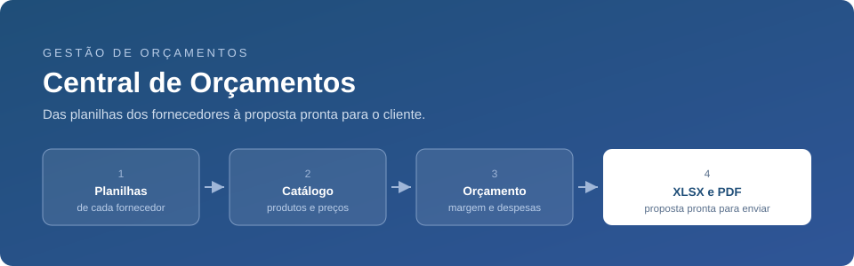
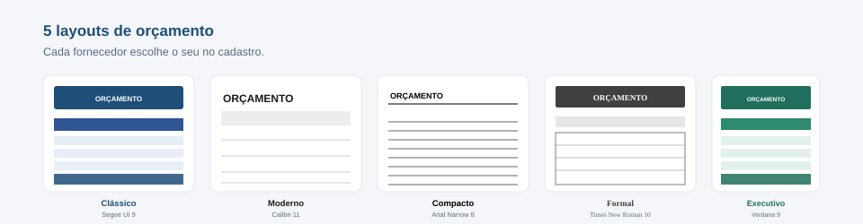

# Central de Orçamentos




**Gere orçamentos profissionais a partir das planilhas dos seus fornecedores — em
minutos, não em horas.**

Sistema web de uso próprio para empresas que cotam com vários fornecedores e precisam
entregar uma proposta bonita ao cliente. Você joga as planilhas de cada fornecedor
para dentro, o sistema organiza o catálogo, compara preços, aplica margem, e devolve
**planilha Excel e PDF prontos**, no layout da sua empresa.

> **Versão 2** — o trabalho agora nasce no **projeto**: uma proposta **vencedora** e
> os **concorrentes** derivados dela com aumento percentual. A plataforma entrega o
> PDF de todas em sequência e o pacote de planilhas para enviar ao cliente.
> A versão anterior está na tag [`v1.0`](../../releases/tag/v1.0).

---

## O problema que ele resolve

Quem monta orçamento com mais de um fornecedor conhece o roteiro:

- cada fornecedor manda uma planilha com colunas diferentes;
- os preços mudam toda semana e ficam espalhados em arquivos;
- montar a proposta do cliente é copiar e colar no Excel, linha por linha;
- aumentar a margem significa refazer conta em cada célula;
- fazer a mesma proposta por três fornecedores diferentes, então, é o dia inteiro;
- e ainda tem o risco de mandar para o cliente uma planilha com o **custo** à mostra.

## A solução

Um sistema que faz esse caminho sozinho:

1. **Importa** a planilha de cada fornecedor, mesmo com layout diferente do outro;
2. **Organiza** um catálogo por fornecedor, com descrição, marca, estoque, EAN,
   código do fabricante, referência e NCM;
3. **Compara** o mesmo item entre fornecedores e mostra o mais barato;
4. **Monta** o orçamento com margem, serviço e outras despesas;
5. **Gera** a planilha Excel e o PDF — sem custo nem margem aparentes para o cliente.

---

## Principais recursos

### Catálogo por fornecedor

Cada fornecedor tem o **seu próprio catálogo**, alimentado pela planilha que ele envia.

- lê `.xlsx` e `.csv`;
- **descobre sozinho** a linha de cabeçalho e qual coluna é qual;
- mostra uma tela de conferência com amostra dos dados antes de importar;
- você pode corrigir o mapeamento e ele fica salvo para a próxima vez;
- modo **atualizar** (mantém e atualiza preços) ou **substituir** o catálogo inteiro.

Campos reconhecidos: descrição, valor unitário, marca, estoque, código do fabricante,
código de barras (EAN), referência e NCM. Também dá para **criar e editar produto**
manualmente, sem planilha.

### Comparação de preços

Ao incluir um item, o sistema procura o **mesmo produto nos outros fornecedores**
(por EAN, código do fabricante ou referência), marca o mais barato e mostra a
diferença em reais. Trocar o fornecedor da linha troca o custo automaticamente.

O **Comparativo** gera uma planilha com todos os fornecedores lado a lado, o menor
preço por item, a economia e o total de cada um.

### Orçamento

| Recurso | O que faz |
|---|---|
| **Margem** | markup sobre o custo ou margem sobre o preço de venda |
| **Preço de venda editável** | digite o preço final de um item, ignorando a margem naquela linha |
| **Serviço de instalação** | percentual sobre os produtos; **0 = orçamento sem serviço** |
| **Outras despesas** | percentual ou valor fixo sobre produtos, serviços ou total |
| **Arredondamento** | sobe o preço para o próximo múltiplo (ex.: R$ 0,10) |
| **Fornecedores misturados** | cada linha pode vir de um fornecedor diferente |
| **Clonar** | cria o mesmo orçamento para outro fornecedor com ajuste % sobre o preço final |

O painel calcula em tempo real: custo, produtos, serviços, despesas, total,
**lucro bruto**, **margem efetiva** e **markup real**.

### Projeto: vencedor e perdedores

**Cada orçamento é a proposta de uma empresa participante.** O cabeçalho, o CNPJ, o
endereço, os dados bancários e o layout vêm do cadastro dessa empresa — todas emitem
a sua proposta e todas vão para o cliente.

A tela do projeto é o centro do trabalho:

- o **vencedor** aparece em destaque, com total e ações;
- os **perdedores** ficam listados com o aumento aplicado a cada um;
- **Adicionar perdedor** pede só o título, a **empresa participante** e o aumento em
  % — o resto é herdado do vencedor;
- o primeiro orçamento criado no projeto vira **vencedor automaticamente**;
- a empresa participante pode ser trocada a qualquer momento no orçamento em
  rascunho, em *Dados da proposta*;
- **PDF de todas as propostas** gera um documento único, com quebra de página entre
  elas;
- **Baixar planilhas (.zip)** entrega um `.xlsx` por proposta, nomeados em ordem,
  com o vencedor identificado.

Ao escolher a empresa participante, o nome sugerido no título acompanha a escolha —
não é preciso digitar de novo.

### Documento do cliente

**Planilha Excel** com fórmulas reais, editável, no layout da empresa:

- uma aba por orçamento, com cabeçalho do fornecedor e do cliente;
- aba de custos **oculta** — a memória de cálculo fica fora do alcance do cliente;
- aba **RESUMO CONSOLIDADO** quando o projeto tem várias unidades;
- margem e percentual de serviço **não aparecem** no documento.

**PDF** em A4, pronto para enviar: cabeçalho, itens, totais, observações e dados
bancários. A página sai **limpa** — sem menu, sem título da plataforma, sem data e
sem URL. A margem da página é zerada no CSS, o que também elimina o cabeçalho e o
rodapé automáticos do navegador.

### 5 layouts



O layout é escolhido **no cadastro do fornecedor** e aplicado automaticamente quando
ele assina a proposta — tanto na **planilha** quanto no **PDF**. Cada um muda fonte,
tamanho, cores, bordas e espaçamento:

| Layout | Fonte | Perfil |
|---|---|---|
| **Clássico** | Segoe UI 9 | azul institucional, cabeçalho preenchido |
| **Moderno** | Calibri 11 | título grande, linhas só na base, visual limpo |
| **Compacto** | Arial Narrow 8 | sem preenchimento, cabe mais item por página |
| **Formal** | Times New Roman 10 | caixa cinza escuro, aparência de documento |
| **Executivo** | Verdana 9 | verde-petróleo, espaçado, proposta premium |

Para comparar antes de escolher, cada layout tem um **exemplo para download** em
*Fornecedores → Layout do orçamento*.

### Administração

- usuários com perfil **administrador** e **usuário**;
- clientes, fornecedores, produtos e projetos;
- projetos agrupam vários orçamentos (ex.: as escolas de um mesmo edital);
- configuração da empresa principal, dados bancários, layouts e padrões de cálculo.

---

## Como funciona

O **projeto** é o ponto de partida. Dentro dele ficam uma proposta **vencedora**
(a mais barata, a que deve ganhar) e as **perdedoras**, geradas a partir dela com
aumentos percentuais — como uma disputa real entre fornecedores.

```
Projeto ─► Orçamento vencedor
              │
              ├─ perdedor  +8%
              ├─ perdedor +15%   ──►  PDF de todas + pacote de planilhas
              └─ perdedor +22%
```

**Cenário típico:** você cria o projeto, monta o orçamento vencedor com o
fornecedor mais barato, e gera os concorrentes informando o aumento de cada um.
A plataforma devolve **um PDF com todas as propostas em sequência** e **um pacote
com todas as planilhas** — prontos para enviar ao cliente.

---

## Instalação

A imagem é publicada automaticamente no GitHub Container Registry.

### Um comando (Linux / CasaOS / ZimaOS)

```bash
curl -fsSL https://raw.githubusercontent.com/SamuelNoia/orca3/main/instalar.sh | sh
```

O script baixa a imagem, cria a pasta de dados, sobe o container na porta **3088** e
exibe a senha de acesso gerada. Rodar de novo atualiza a imagem **mantendo os dados**.

### Docker Compose

```bash
docker compose -f docker-compose.ghcr.yml up -d
```

### Sem Docker (Windows)

Baixe o projeto e dê duplo clique em **`iniciar.cmd`** (requer Node.js 22.5+).

### Primeiro acesso

| Campo | Valor |
|---|---|
| E-mail | `admin@empresa.local` |
| Senha | **gerada automaticamente** na primeira execução |

A senha aparece no log (`docker logs orcamentos`) e em
`data/PRIMEIRO_ACESSO.txt`. Não existe senha fixa no código — cada instalação nasce
com uma diferente. Troque em *Usuários → Administrador*.

### Variáveis de ambiente

| Variável | Padrão | Para que serve |
|---|---|---|
| `PORT` | `3000` | porta interna do container |
| `DATA_DIR` | `/app/data` | pasta do banco e arquivos |
| `ADMIN_EMAIL` | `admin@empresa.local` | login do administrador |
| `ADMIN_PASSWORD` | *(aleatória)* | senha inicial, se quiser definir |
| `SEED` | `inicial` | `inicial` (base com 1 produto de teste), `none` ou `demo` |
| `TZ` | `America/Sao_Paulo` | fuso horário |

---

## Uso no dia a dia

1. **Cadastre a empresa** em *Configurações* (razão social, CNPJ, endereço, banco e
   layout padrão).
2. **Cadastre os fornecedores** e envie a planilha de cada um.
3. **Cadastre o cliente** e crie o **projeto**.
4. **Crie o orçamento vencedor**: adicione os produtos e ajuste margem, serviço e
   despesas. Ele já nasce marcado como vencedor.
5. **Adicione os perdedores** informando o aumento de cada um (ex.: 8%, 15%, 22%).
6. Em **Documentos para o cliente**, baixe o **PDF de todas as propostas** e o
   **pacote de planilhas** (.zip). Envie ao cliente.

---

## Backup

Tudo está em `data/` — o banco é um único arquivo SQLite. Copie a pasta com o
container parado e você tem o backup completo: clientes, fornecedores, catálogos,
orçamentos e usuários.

---

## Segurança

- senhas com **scrypt** e salt individual;
- sessão em cookie `HttpOnly` + `SameSite=Lax`;
- **proteção CSRF** em todos os formulários;
- bloqueio após 8 tentativas de login erradas;
- perfis de acesso separados;
- margem e custo nunca aparecem no documento do cliente.

Para expor na internet, coloque atrás de um proxy com **HTTPS** e troque a senha
padrão.

---

## Tecnologia

| | |
|---|---|
| Runtime | Node.js 24 |
| Banco | SQLite (`node:sqlite`, nativo) |
| Servidor | `node:http`, sem framework |
| Interface | HTML renderizado no servidor + CSS próprio |
| Excel | gerador e leitor XLSX próprios (ZIP + XML) |
| Dependências externas | **nenhuma** |

Sem `npm install`, sem build de front-end, sem ORM. Um arquivo de banco e um processo.

---

## Estrutura

```
orca3/
├── server.js                 servidor HTTP
├── Dockerfile                imagem de produção
├── docker-compose.ghcr.yml   compose com a imagem publicada
├── instalar.sh               instalação em um comando
├── iniciar.cmd               execução no Windows
├── docs/                     imagens de apresentação
├── public/                   CSS e JS da interface
├── src/
│   ├── db.js                 schema e acesso ao SQLite
│   ├── auth.js               senhas, sessões, CSRF
│   ├── web.js                rotas, cookies, formulários, upload
│   ├── xlsx.js               leitor/gerador de XLSX (ZIP + XML)
│   ├── layouts.js            os 5 layouts visuais
│   ├── modelo.js             planilha modelo para fornecedores
│   ├── importer.js           detecção de colunas e importação
│   ├── calc.js               motor de margem, despesas e serviço
│   ├── clone.js              clonagem (base do perdedor)
│   ├── print.js              folha A4 para PDF
│   ├── exporter.js           planilha e comparativo
│   ├── repo.js               consultas de dados
│   ├── ui.js                 componentes de tela
│   └── routes/               telas: auth, admin, catalog, project, quotes
└── tools/
    ├── seed-inicial.js       base zerada + 1 produto de teste
    ├── seed-demo.js          carrega uma planilha consolidada
    ├── gerar-modelo.js       gera a planilha modelo
    ├── gerar-pacote.js       empacota para deploy manual
    └── selftest.js           teste de ponta a ponta
```

---

## Testes

```bash
node tools/selftest.js
```

**149 verificações** de ponta a ponta, num banco temporário isolado: login e
permissões, CSRF, cadastros, importação de dois layouts de planilha diferentes,
planilha modelo (ida e volta), preço de venda manual, orçamento sem serviço, os
5 layouts, clonagem com ajuste, projeto com vencedor e perdedores, PDF de todas as
propostas, pacote de planilhas, comparativo, exportação, consolidado e estrutura
HTML das telas.

---

## Limitações conhecidas

- O PDF é gerado pelo diálogo de impressão do navegador (*Salvar como PDF*).
- A comparação entre fornecedores depende de EAN, código do fabricante ou
  referência estarem preenchidos no catálogo.
- Não há controle de estoque nem emissão fiscal — o foco é o orçamento.
- Feito para uso próprio; não é um SaaS multiusuário com isolamento por empresa.
